# Student Academic & Course Management System — Diagrams

This file contains all system diagrams for the **Student Academic & Course Management System**.
All diagrams are written in **Mermaid** syntax and can be rendered in GitHub, GitLab, Notion, Obsidian, draw.io, or [mermaid.live](https://mermaid.live).

---

## 1. System Architecture (Layered)

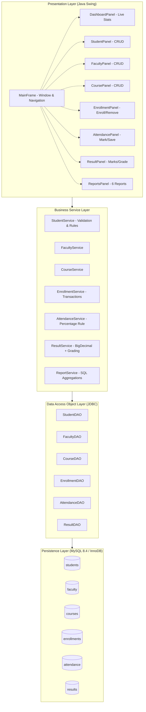

---

## 2. Package / Module Dependency Diagram

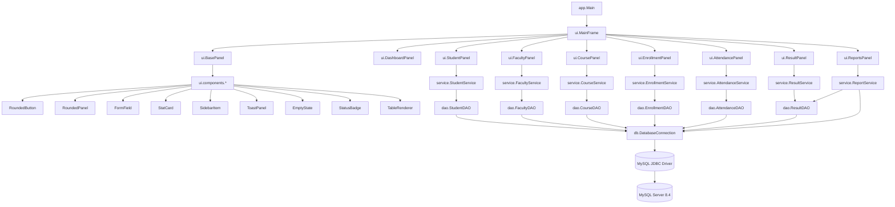

---

## 3. Entity-Relationship (ER) Diagram — Database Schema

```mermaid
erDiagram
    students ||--o{ enrollments : "has"
    faculty ||--o{ courses : "assigns (SET NULL)"
    courses ||--o{ enrollments : "has"
    enrollments ||--|{ attendance : "has"
    enrollments ||--|{ results : "has (1:1)"

    students {
        int id PK
        varchar student_id UK
        varchar roll_number UK
        varchar full_name
        varchar email UK
        varchar phone
        text address
        date date_of_birth
        varchar department
        tinyint semester
        date admission_date
    }

    faculty {
        int id PK
        varchar faculty_id UK
        varchar employee_id UK
        varchar full_name
        varchar email UK
        varchar phone
        text address
        date date_of_birth
        varchar department
        varchar designation
        varchar specialization
    }

    courses {
        int id PK
        varchar course_code UK
        varchar course_name
        varchar department
        tinyint semester
        int credits
        decimal maximum_marks
        decimal passing_marks
        int assigned_faculty_id FK
    }

    enrollments {
        int id PK
        int student_id FK
        int course_id FK
        date enrollment_date
        enum status Active/Completed/Dropped
    }

    attendance {
        int id PK
        int enrollment_id FK
        date class_date
        enum status PRESENT/ABSENT/LATE
    }

    results {
        int id PK
        int enrollment_id FK UK
        decimal marks_obtained
        decimal percentage
        char grade
    }

    students ||--o{ results : "has (via enrollment)"
    courses ||--o{ results : "has (via enrollment)"
```

**Foreign-Key Deletion Policy:**
| Relationship | FK Action | Reason |
|-------------|-----------|--------|
| students → enrollments | `RESTRICT` | Protect academic history |
| courses → enrollments | `RESTRICT` | Protect academic history |
| enrollments → attendance | `RESTRICT` | Prevent accidental history loss |
| enrollments → results | `RESTRICT` | One final result per enrollment |
| faculty → courses | `SET NULL` | Deliberate exception: courses remain unassigned when faculty leaves |

---

## 4. OOP Class Diagram (UML)

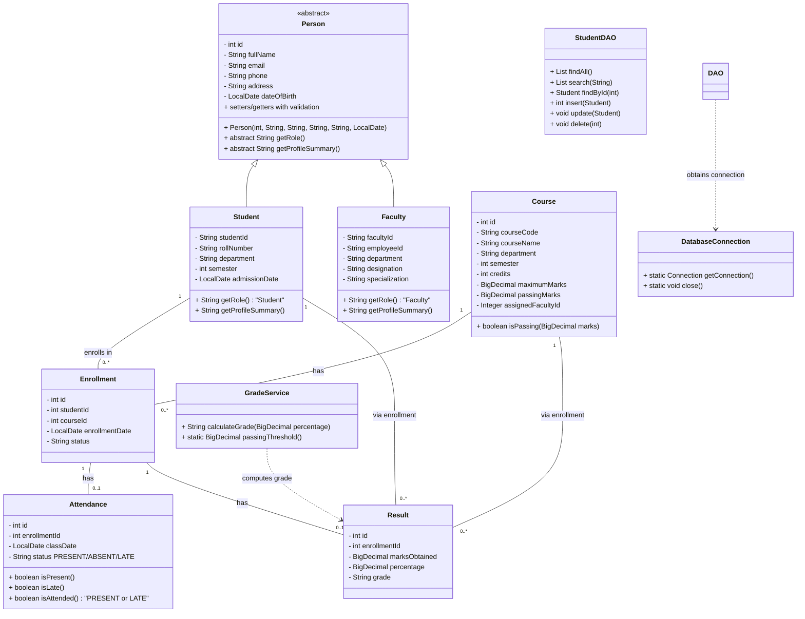

**OOP Concept Mapping:**
| Concept | Implementation |
|---------|---------------|
| **Encapsulation** | All model fields `private`; validated getters/setters (`Student.setSemester`, `Course.setPassingMarks`) |
| **Inheritance** | `Person` → `Student`, `Person` → `Faculty` |
| **Abstraction** | `Person` is `abstract`; DAO/Service hide SQL & business rules |
| **Polymorphism** | `Student.getRole()` returns `"Student"`, `Faculty.getRole()` returns `"Faculty"`; `Person ref = new Student()` |
| **Classes & Objects** | 7 domain model objects instantiated from UI input and database `ResultSet` |

---

## 5. Workflow / Activity Diagrams

### 5.1 Student CRUD Workflow

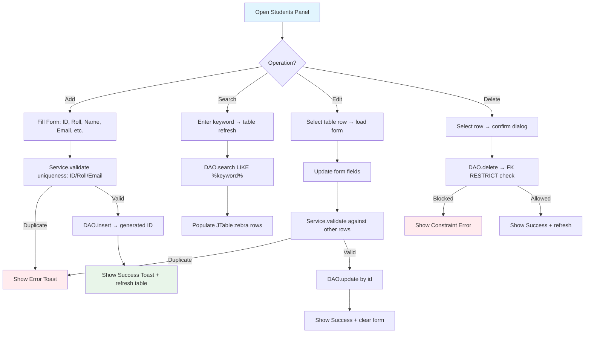

### 5.2 Enrollment Workflow (Transactional)

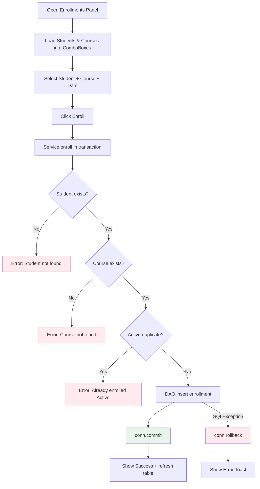

### 5.3 Attendance Entry Workflow

```mermaid
flowchart TD
    A[Open Attendance Panel] --> B[Select Course + Class Date]
    B --> C[Validate: date not future]
    C -->|Future| D[Error: Future date not allowed]
    C -->|Valid| E[Load enrollments for course]
    E --> F[Pre-fill existing attendance for date]
    F --> G[Mark each student: PRESENT / ABSENT / LATE]
    G --> H[Click Save Attendance]
    H --> I[Service.save in transaction]
    I --> J[DELETE existing rows for course/date]
    J --> K[INSERT batch attendance records]
    K --> L[conn.commit]
    L --> M[Show Success Toast]
    I -->|Exception| N[conn.rollback]
    N --> O[Show Error Toast]

    percentage[Attendance % Rule<br/>(Present + Late) / Total × 100]
    I -.-> percentage
    style percentage fill:#fff3e0
```

**Attendance Rule:** `Attendance % = (Present + Late) / Total Recorded Sessions × 100`  
Late counts as attended. Future dates are never stored as absences.

---

### 5.4 Marks & Result Entry Workflow

```mermaid
flowchart TD
    A[Open Results Panel] --> B[Load Enrollments into ComboBox]
    B --> C[Select Enrollment + Enter Marks]
    C --> D[Click Save Result]
    D --> E[Service.validate enrollment exists]
    E -->|No| F[Error: Enrollment not found]
    E -->|Yes| G[Validate marks: 0 ≤ marks ≤ course.maximum_marks]
    G -->|Invalid| H[Error: Marks out of range]
    G -->|Valid| I[Compute percentage = marks/max × 100 BigDecimal]
    I --> J[GradeService.calculateGrade percentage]
    J --> K[DAO.save result → one per enrollment]
    K --> L[conn.commit]
    L --> M[Show Success: Percentage + Grade]
    K -->|Duplicate| N[Error: Result already exists]

    grade_scale[Grading Scale:<br/>A: 90-100 \| B: 80-89.99 \|<br/>C: 70-79.99 \| D: 60-69.99 \|<br/>E: 50-59.99 \| F: <50]
    J -.-> grade_scale
    style grade_scale fill:#f3e5f5
    style M fill:#e8f5e9
    style N fill:#ffebee
```

---

## 6. Sequence Diagrams

### 6.1 Add Student Sequence

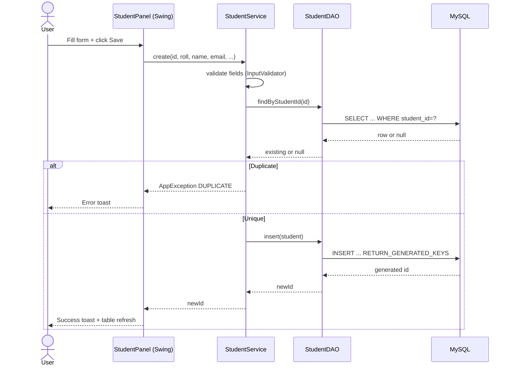

### 6.2 Mark Attendance Sequence

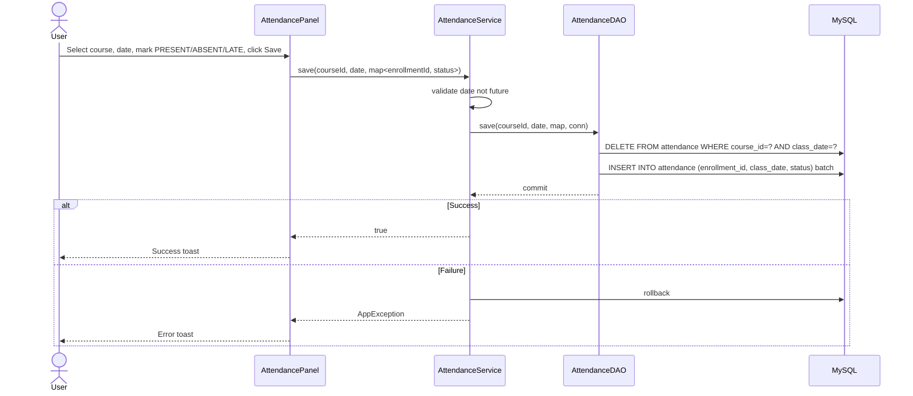

### 6.3 Save Result Sequence

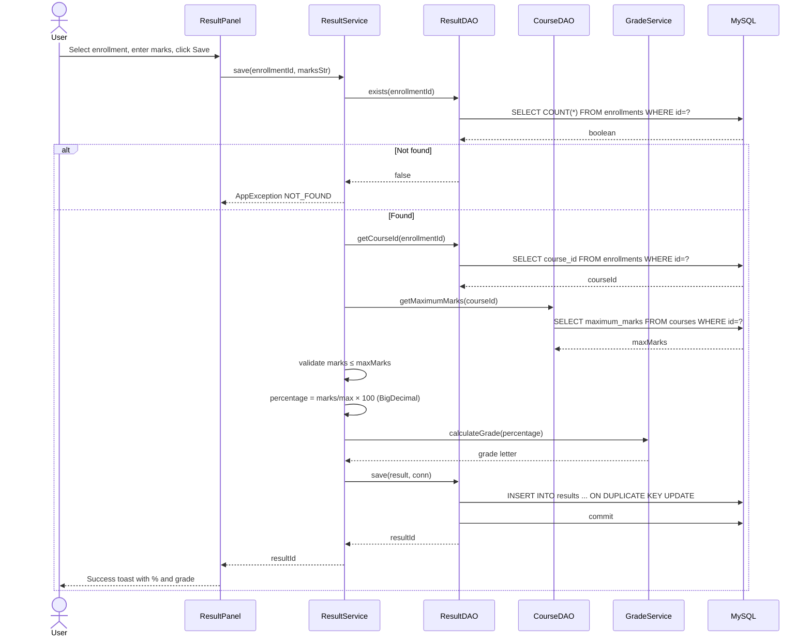

---

## 7. State Machine Diagram — Enrollment Status

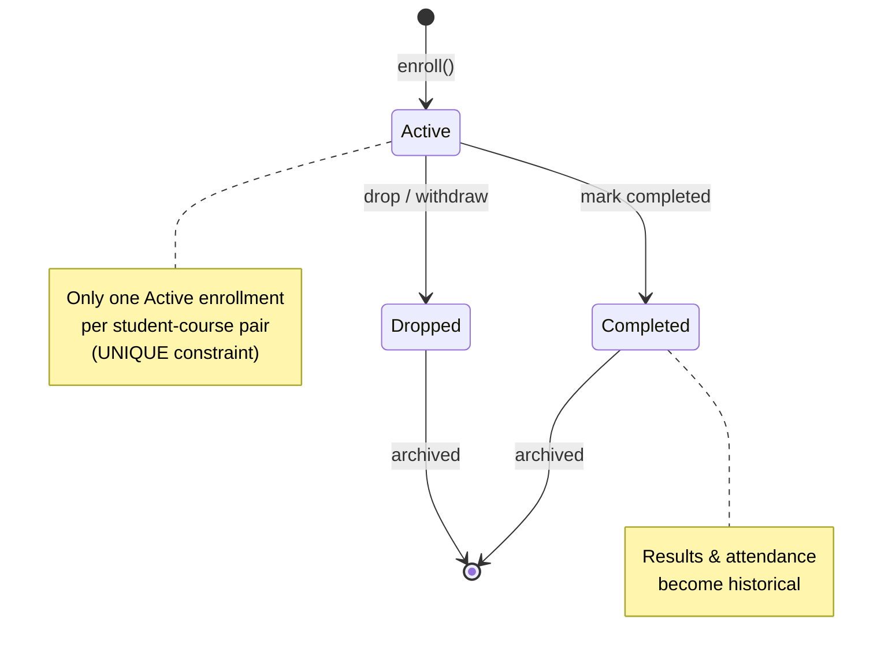

### Attendance Status States

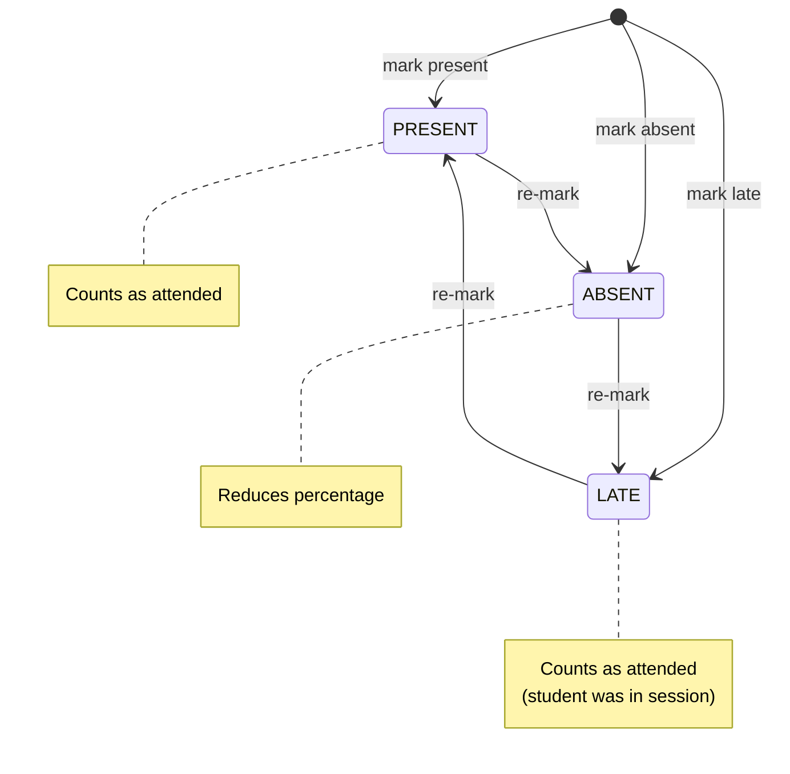

---

## 8. Data Flow Diagram (DFD) — Level 1

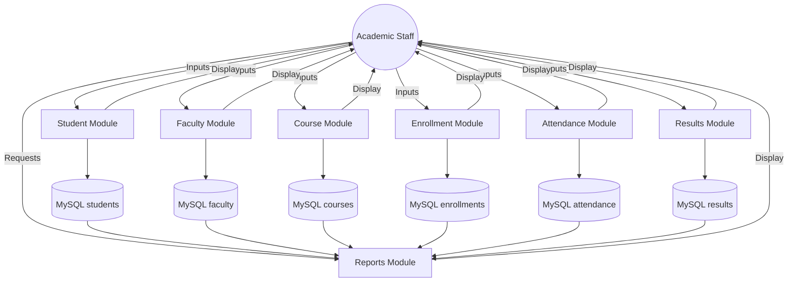

---

## 9. Deployment / Run Diagram

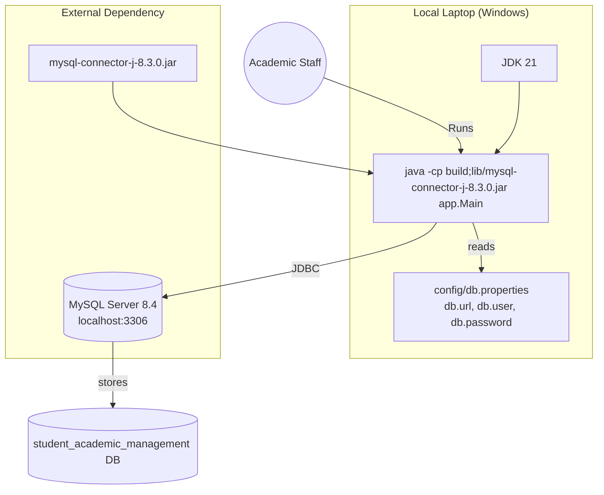

---

## 10. Dashboard Layout (Mock)

```
┌─────────────────────────────────────────────────────────────┐
│ Dashboard                          ● Connected to MySQL  [⟳] │
├─────────────┬─────────────┬─────────────┬───────────────────┤
│ Total Students │ Total Faculty │ Total Courses │ Avg Attendance │
│     1,234       │      56       │      28       │     87.50%     │
│   ● navy        │    ● navy-dark │    ● indigo   │     ● blue     │
├─────────────┴─────────────┴─────────────┴───────────────────┤
│ Recently Added Students           Recent Enrollments        │
│ ┌─────┬──────┬────────┬─────────┬────────┐ ┌─────┬──────┐  │
│ │ ID  │ Roll │ Name   │ Email   │ Dept   │ │ ID  │ Student│  │
│ └─────┴──────┴────────┴─────────┴────────┘ └─────┴──────┘  │
└─────────────────────────────────────────────────────────────┘
```

---

## 11. Project Directory Structure

```
Student-Academic-and-cource-management/
├── src/
│  ├── app/Main.java
│  ├── model/{Person,Student,Faculty,Course,Enrollment,Attendance,Result}.java
│  ├── dao/{Student,Faculty,Course,Enrollment,Attendance,Result}DAO.java
│  ├── service/{Student,Faculty,Course,Enrollment,Attendance,Result,Grade,Report}Service.java
│  ├── db/DatabaseConnection.java
│  ├── ui/{MainFrame,Dashboard,Student,Faculty,Course,Enrollment,Attendance,Result,Reports}Panel.java
│  ├── ui/components/{RoundedPanel,RoundedButton,FormField,StatCard,SidebarItem,ToastPanel,EmptyState,StatusBadge,TableRenderer}.java
│  └── util/{UIStyles,InputValidator,DateUtils,AppException}.java
├── lib/mysql-connector-j-8.3.0.jar
├── sql/schema.sql
├── sql/sample-data.sql
├── config/db.properties.example
├── README.md
├── TESTING.md
└── RUN_LOCALLY.bat
```

---

## 12. How to View These Diagrams

1. **Copy any `mermaid` code block** above.
2. Paste it into:
   - A `.md` file on GitHub / GitLab (renders natively)
   - [mermaid.live](https://mermaid.live) (standalone editor)
   - Obsidian, Notion, or draw.io (Mermaid import)
   - VS Code with the Mermaid Preview extension

---

*Generated for the Student Academic & Course Management System — JDK 21 + MySQL + JDBC + Java Swing*
