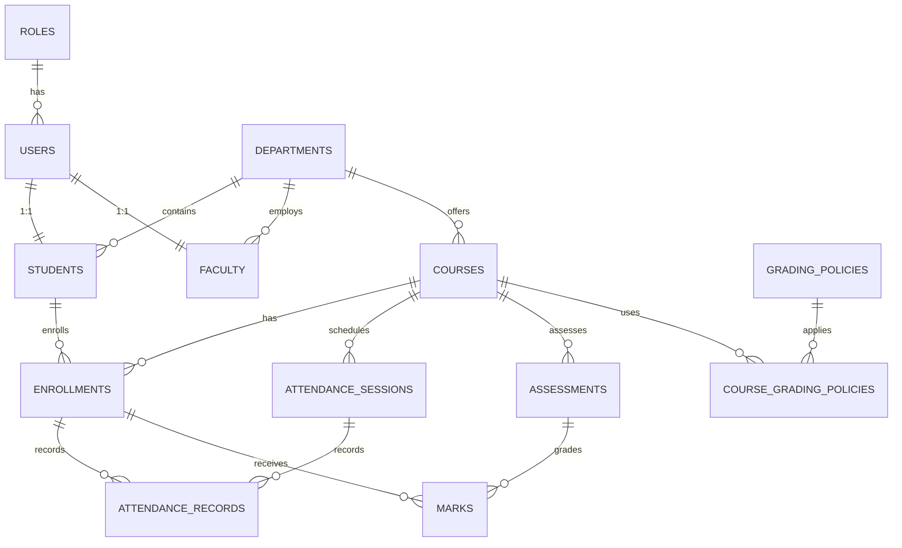

# Database Design Documentation

## Overview

The Student Academic and Course Management System uses a **MySQL 8.0** relational database with a normalized schema designed for academic management. The schema supports students, faculty, courses, enrollments, attendance, assessments, and grading.

## Entity Relationship Diagram



## Table Definitions

### 1. Roles & Users

#### `roles`
| Column | Type | Constraints | Description |
|--------|------|-------------|-------------|
| id | BIGINT UNSIGNED | PK, AI | Unique identifier |
| name | VARCHAR(50) | UNIQUE, NN | Role name (ADMIN, FACULTY, STUDENT, etc.) |
| description | VARCHAR(255) | | Role description |
| created_at | TIMESTAMP | DEFAULT CURRENT_TIMESTAMP | Creation timestamp |
| updated_at | TIMESTAMP | DEFAULT CURRENT_TIMESTAMP ON UPDATE | Last update |

**Indexes**: `idx_roles_name` (UNIQUE)

#### `users`
| Column | Type | Constraints | Description |
|--------|------|-------------|-------------|
| id | BIGINT UNSIGNED | PK, AI | Unique identifier |
| username | VARCHAR(100) | UNIQUE, NN | Login username |
| email | VARCHAR(255) | UNIQUE, NN | Email address |
| password_hash | VARCHAR(255) | NN | BCrypt hashed password |
| full_name | VARCHAR(255) | NN | Display name |
| phone | VARCHAR(20) | | Phone number |
| avatar_url | VARCHAR(500) | | Profile image URL |
| role_id | BIGINT UNSIGNED | FK→roles.id, NN | User role |
| is_active | BOOLEAN | DEFAULT TRUE | Account status |
| last_login_at | TIMESTAMP | NULLABLE | Last login timestamp |
| email_verified | BOOLEAN | DEFAULT FALSE | Email verification status |
| created_at | TIMESTAMP | DEFAULT CURRENT_TIMESTAMP | Creation timestamp |
| updated_at | TIMESTAMP | DEFAULT CURRENT_TIMESTAMP ON UPDATE | Last update |

**Indexes**: `idx_users_email` (UNIQUE), `idx_users_username` (UNIQUE), `idx_users_role`, `idx_users_active`
**Foreign Keys**: `role_id` → `roles.id` (RESTRICT)

### 2. Academic Structure

#### `departments`
| Column | Type | Constraints | Description |
|--------|------|-------------|-------------|
| id | BIGINT UNSIGNED | PK, AI | Unique identifier |
| code | VARCHAR(20) | UNIQUE, NN | Department code (CS, EE, ME) |
| name | VARCHAR(255) | NN | Department name |
| description | TEXT | | Description |
| head_faculty_id | BIGINT UNSIGNED | FK→faculty.id, NULLABLE | Department head |
| is_active | BOOLEAN | DEFAULT TRUE | Active status |
| created_at | TIMESTAMP | DEFAULT CURRENT_TIMESTAMP | Creation timestamp |
| updated_at | TIMESTAMP | DEFAULT CURRENT_TIMESTAMP ON UPDATE | Last update |

**Indexes**: `idx_departments_code` (UNIQUE), `idx_departments_active`
**Foreign Keys**: `head_faculty_id` → `faculty.id` (SET NULL)

#### `students`
| Column | Type | Constraints | Description |
|--------|------|-------------|-------------|
| id | BIGINT UNSIGNED | PK, AI | Unique identifier |
| student_id | VARCHAR(50) | UNIQUE, NN | Student ID number |
| user_id | BIGINT UNSIGNED | FK→users.id, UNIQUE, NN | User account |
| department_id | BIGINT UNSIGNED | FK→departments.id, NN | Academic department |
| admission_year | YEAR | NN | Year of admission |
| current_semester | TINYINT UNSIGNED | DEFAULT 1, NN | Current semester |
| status | ENUM | DEFAULT 'ACTIVE' | ACTIVE, INACTIVE, GRADUATED, SUSPENDED, WITHDRAWN |
| date_of_birth | DATE | | Birth date |
| gender | ENUM | | MALE, FEMALE, OTHER, PREFER_NOT_TO_SAY |
| address | TEXT | | Home address |
| emergency_contact_name | VARCHAR(255) | | Emergency contact |
| emergency_contact_phone | VARCHAR(20) | | Emergency phone |
| blood_group | VARCHAR(5) | | Blood group (A+, B-, etc.) |
| created_at | TIMESTAMP | DEFAULT CURRENT_TIMESTAMP | Creation timestamp |
| updated_at | TIMESTAMP | DEFAULT CURRENT_TIMESTAMP ON UPDATE | Last update |

**Indexes**: `idx_students_student_id` (UNIQUE), `idx_students_department`, `idx_students_status`, `idx_students_admission_year`, `idx_students_semester`
**Foreign Keys**: `user_id` → `users.id` (CASCADE), `department_id` → `departments.id` (RESTRICT)

#### `faculty`
| Column | Type | Constraints | Description |
|--------|------|-------------|-------------|
| id | BIGINT UNSIGNED | PK, AI | Unique identifier |
| faculty_id | VARCHAR(50) | UNIQUE, NN | Faculty ID number |
| user_id | BIGINT UNSIGNED | FK→users.id, UNIQUE, NN | User account |
| department_id | BIGINT UNSIGNED | FK→departments.id, NN | Academic department |
| designation | ENUM | NN | PROFESSOR, ASSOCIATE_PROFESSOR, ASSISTANT_PROFESSOR, LECTURER, ADJUNCT, VISITING |
| specialization | VARCHAR(255) | | Research specialization |
| qualification | TEXT | | Academic qualifications |
| hire_date | DATE | NN | Hire date |
| status | ENUM | DEFAULT 'ACTIVE' | ACTIVE, INACTIVE, ON_LEAVE, RETIRED |
| office_location | VARCHAR(255) | | Office location |
| research_interests | TEXT | | Research interests |
| created_at | TIMESTAMP | DEFAULT CURRENT_TIMESTAMP | Creation timestamp |
| updated_at | TIMESTAMP | DEFAULT CURRENT_TIMESTAMP ON UPDATE | Last update |

**Indexes**: `idx_faculty_faculty_id` (UNIQUE), `idx_faculty_department`, `idx_faculty_status`, `idx_faculty_designation`
**Foreign Keys**: `user_id` → `users.id` (CASCADE), `department_id` → `departments.id` (RESTRICT)

### 3. Course Management

#### `courses`
| Column | Type | Constraints | Description |
|--------|------|-------------|-------------|
| id | BIGINT UNSIGNED | PK, AI | Unique identifier |
| course_code | VARCHAR(20) | UNIQUE, NN | Course code (CS101, MATH201) |
| title | VARCHAR(255) | NN | Course title |
| description | TEXT | | Course description |
| credits | TINYINT UNSIGNED | DEFAULT 3, NN | Credit hours |
| department_id | BIGINT UNSIGNED | FK→departments.id, NN | Owning department |
| semester | TINYINT UNSIGNED | NN | Semester number (1-8) |
| faculty_id | BIGINT UNSIGNED | FK→faculty.id, NULLABLE | Assigned faculty |
| max_enrollment | INT UNSIGNED | DEFAULT 60, NN | Maximum students |
| prerequisites | TEXT | | Prerequisite courses |
| syllabus_url | VARCHAR(500) | | Syllabus URL |
| status | ENUM | DEFAULT 'ACTIVE' | ACTIVE, INACTIVE, ARCHIVED |
| academic_year | VARCHAR(20) | NN | Academic year (2024-2025) |
| created_at | TIMESTAMP | DEFAULT CURRENT_TIMESTAMP | Creation timestamp |
| updated_at | TIMESTAMP | DEFAULT CURRENT_TIMESTAMP ON UPDATE | Last update |

**Indexes**: `idx_courses_code` (UNIQUE), `idx_courses_department`, `idx_courses_semester`, `idx_courses_faculty`, `idx_courses_status`, `idx_courses_academic_year`
**Foreign Keys**: `department_id` → `departments.id` (RESTRICT), `faculty_id` → `faculty.id` (SET NULL)

#### `enrollments`
| Column | Type | Constraints | Description |
|--------|------|-------------|-------------|
| id | BIGINT UNSIGNED | PK, AI | Unique identifier |
| student_id | BIGINT UNSIGNED | FK→students.id, NN | Enrolled student |
| course_id | BIGINT UNSIGNED | FK→courses.id, NN | Enrolled course |
| enrollment_date | DATE | DEFAULT CURRENT_DATE, NN | Enrollment date |
| status | ENUM | DEFAULT 'ENROLLED' | ENROLLED, DROPPED, COMPLETED, WITHDRAWN, FAILED |
| grade | VARCHAR(5) | | Final grade (A+, A, B+, etc.) |
| grade_points | DECIMAL(3,2) | | Grade points (0.0-10.0) |
| completion_date | DATE | | Completion date |
| created_at | TIMESTAMP | DEFAULT CURRENT_TIMESTAMP | Creation timestamp |
| updated_at | TIMESTAMP | DEFAULT CURRENT_TIMESTAMP ON UPDATE | Last update |

**Indexes**: `idx_enrollments_student`, `idx_enrollments_course`, `idx_enrollments_status`, `idx_enrollments_date`
**Unique Constraint**: `uk_student_course` (student_id, course_id)
**Foreign Keys**: `student_id` → `students.id` (CASCADE), `course_id` → `courses.id` (CASCADE)

### 4. Attendance System

#### `attendance_sessions`
| Column | Type | Constraints | Description |
|--------|------|-------------|-------------|
| id | BIGINT UNSIGNED | PK, AI | Unique identifier |
| course_id | BIGINT UNSIGNED | FK→courses.id, NN | Course |
| session_date | DATE | NN | Session date |
| session_number | INT UNSIGNED | NN | Session number in course |
| topic | VARCHAR(255) | | Session topic |
| duration_minutes | INT UNSIGNED | DEFAULT 60, NN | Duration in minutes |
| is_cancelled | BOOLEAN | DEFAULT FALSE | Cancellation flag |
| cancellation_reason | VARCHAR(255) | | Reason if cancelled |
| created_by | BIGINT UNSIGNED | FK→users.id, NN | Creator |
| created_at | TIMESTAMP | DEFAULT CURRENT_TIMESTAMP | Creation timestamp |
| updated_at | TIMESTAMP | DEFAULT CURRENT_TIMESTAMP ON UPDATE | Last update |

**Indexes**: `idx_sessions_course`, `idx_sessions_date`, `idx_sessions_cancelled`
**Unique Constraint**: `uk_course_session` (course_id, session_date, session_number)
**Foreign Keys**: `course_id` → `courses.id` (CASCADE), `created_by` → `users.id` (RESTRICT)

#### `attendance_records`
| Column | Type | Constraints | Description |
|--------|------|-------------|-------------|
| id | BIGINT UNSIGNED | PK, AI | Unique identifier |
| session_id | BIGINT UNSIGNED | FK→attendance_sessions.id, NN | Session |
| enrollment_id | BIGINT UNSIGNED | FK→enrollments.id, NN | Enrollment |
| status | ENUM | DEFAULT 'ABSENT' | PRESENT, ABSENT, LATE, EXCUSED, MEDICAL |
| remarks | VARCHAR(500) | | Remarks |
| recorded_by | BIGINT UNSIGNED | FK→users.id, NN | Recorder |
| recorded_at | TIMESTAMP | DEFAULT CURRENT_TIMESTAMP | Record timestamp |
| updated_at | TIMESTAMP | DEFAULT CURRENT_TIMESTAMP ON UPDATE | Last update |

**Indexes**: `idx_attendance_session`, `idx_attendance_enrollment`, `idx_attendance_status`
**Unique Constraint**: `uk_session_enrollment` (session_id, enrollment_id)
**Foreign Keys**: `session_id` → `attendance_sessions.id` (CASCADE), `enrollment_id` → `enrollments.id` (CASCADE), `recorded_by` → `users.id` (RESTRICT)

### 5. Assessment & Grading

#### `assessments`
| Column | Type | Constraints | Description |
|--------|------|-------------|-------------|
| id | BIGINT UNSIGNED | PK, AI | Unique identifier |
| course_id | BIGINT UNSIGNED | FK→courses.id, NN | Course |
| title | VARCHAR(255) | NN | Assessment title |
| description | TEXT | | Description |
| type | ENUM | NN | QUIZ, MIDTERM, FINAL, ASSIGNMENT, PROJECT, LAB, PRESENTATION, PARTICIPATION, OTHER |
| max_marks | DECIMAL(5,2) | NN, >0 | Maximum marks |
| weightage | DECIMAL(5,2) | NN, 0-100 | Weight in final grade |
| assessment_date | DATE | NN | Assessment date |
| due_date | DATETIME | | Due date/time |
| is_published | BOOLEAN | DEFAULT FALSE | Visibility |
| created_by | BIGINT UNSIGNED | FK→users.id, NN | Creator |
| created_at | TIMESTAMP | DEFAULT CURRENT_TIMESTAMP | Creation timestamp |
| updated_at | TIMESTAMP | DEFAULT CURRENT_TIMESTAMP ON UPDATE | Last update |

**Indexes**: `idx_assessments_course`, `idx_assessments_type`, `idx_assessments_date`, `idx_assessments_published`
**Check Constraints**: `weightage` 0-100, `max_marks` > 0

#### `marks`
| Column | Type | Constraints | Description |
|--------|------|-------------|-------------|
| id | BIGINT UNSIGNED | PK, AI | Unique identifier |
| assessment_id | BIGINT UNSIGNED | FK→assessments.id, NN | Assessment |
| enrollment_id | BIGINT UNSIGNED | FK→enrollments.id, NN | Enrollment |
| obtained_marks | DECIMAL(5,2) | DEFAULT 0, ≥0 | Obtained marks |
| graded_by | BIGINT UNSIGNED | FK→users.id, NULLABLE | Grader |
| graded_at | TIMESTAMP | NULLABLE | Grading timestamp |
| feedback | TEXT | | Grader feedback |
| is_finalized | BOOLEAN | DEFAULT FALSE | Finalization flag |
| created_at | TIMESTAMP | DEFAULT CURRENT_TIMESTAMP | Creation timestamp |
| updated_at | TIMESTAMP | DEFAULT CURRENT_TIMESTAMP ON UPDATE | Last update |

**Indexes**: `idx_marks_assessment`, `idx_marks_enrollment`, `idx_marks_finalized`
**Unique Constraint**: `uk_assessment_enrollment` (assessment_id, enrollment_id)
**Check Constraint**: `obtained_marks` ≥ 0
**Foreign Keys**: `assessment_id` → `assessments.id` (CASCADE), `enrollment_id` → `enrollments.id` (CASCADE), `graded_by` → `users.id` (SET NULL)

### 4. Grading Policies

#### `grading_policies`
| Column | Type | Constraints | Description |
|--------|------|-------------|-------------|
| id | BIGINT UNSIGNED | PK, AI | Unique identifier |
| name | VARCHAR(100) | UNIQUE, NN | Policy name |
| description | TEXT | | Description |
| is_default | BOOLEAN | DEFAULT FALSE | Default policy flag |
| grade_boundaries | JSON | NN | Grade→min% mapping |
| created_at | TIMESTAMP | DEFAULT CURRENT_TIMESTAMP | Creation timestamp |
| updated_at | TIMESTAMP | DEFAULT CURRENT_TIMESTAMP ON UPDATE | Last update |

**Indexes**: `idx_grading_policies_default`

#### `course_grading_policies`
| Column | Type | Constraints | Description |
|--------|------|-------------|-------------|
| id | BIGINT UNSIGNED | PK, AI | Unique identifier |
| course_id | BIGINT UNSIGNED | FK→courses.id, NN | Course |
| grading_policy_id | BIGINT UNSIGNED | FK→grading_policies.id, NN | Policy |
| effective_from | DATE | NN | Effective from |
| effective_to | DATE | NULLABLE | Effective until |
| created_at | TIMESTAMP | DEFAULT CURRENT_TIMESTAMP | Creation timestamp |

**Unique Constraint**: `uk_course_policy` (course_id, grading_policy_id, effective_from)
**Foreign Keys**: `course_id` → `courses.id` (CASCADE), `grading_policy_id` → `grading_policies.id` (RESTRICT)

### 5. Audit & Notifications

#### `audit_logs`
| Column | Type | Constraints | Description |
|--------|------|-------------|-------------|
| id | BIGINT UNSIGNED | PK, AI | Unique identifier |
| entity_type | VARCHAR(100) | NN | Entity type |
| entity_id | BIGINT UNSIGNED | NN | Entity ID |
| action | VARCHAR(50) | NN | Action (CREATE, UPDATE, DELETE) |
| old_values | JSON | | Previous values |
| new_values | JSON | | New values |
| performed_by | BIGINT UNSIGNED | FK→users.id, NULLABLE | Actor |
| performed_at | TIMESTAMP | DEFAULT CURRENT_TIMESTAMP | Timestamp |
| ip_address | VARCHAR(45) | | Client IP |
| user_agent | TEXT | | User agent |

**Indexes**: `idx_audit_entity`, `idx_audit_performed_by`, `idx_audit_performed_at`, `idx_audit_action`

#### `notifications`
| Column | Type | Constraints | Description |
|--------|------|-------------|-------------|
| id | BIGINT UNSIGNED | PK, AI | Unique identifier |
| user_id | BIGINT UNSIGNED | FK→users.id, NN | Recipient |
| title | VARCHAR(255) | NN | Notification title |
| message | TEXT | NN | Message content |
| type | ENUM | DEFAULT 'INFO' | INFO, WARNING, ERROR, SUCCESS |
| reference_type | VARCHAR(100) | | Reference entity type |
| reference_id | BIGINT UNSIGNED | | Reference entity ID |
| is_read | BOOLEAN | DEFAULT FALSE | Read status |
| read_at | TIMESTAMP | NULLABLE | Read timestamp |
| created_at | TIMESTAMP | DEFAULT CURRENT_TIMESTAMP | Creation timestamp |

**Indexes**: `idx_notifications_user`, `idx_notifications_read`, `idx_notifications_created`

## Default Data

### Roles (Seeded)
| ID | Name | Description |
|----|------|-------------|
| 1 | ADMIN | System administrator |
| 2 | FACULTY | Teaching faculty |
| 3 | STUDENT | Enrolled student |
| 4 | DEPARTMENT_HEAD | Department administrator |
| 5 | REGISTRAR | Registrar office |

### Default Grading Policy (STANDARD)
```json
{
  "A+": 90, "A": 85, "A-": 80,
  "B+": 75, "B": 70, "B-": 65,
  "C+": 60, "C": 55, "C-": 50,
  "D": 40, "F": 0
}
```

## Indexes Summary

| Table | Index Name | Columns | Type |
|-------|------------|---------|------|
| users | idx_users_email | email | UNIQUE |
| users | idx_users_username | username | UNIQUE |
| users | idx_users_role | role_id | INDEX |
| users | idx_users_active | is_active | INDEX |
| students | idx_students_student_id | student_id | UNIQUE |
| students | idx_students_department | department_id | INDEX |
| students | idx_students_status | status | INDEX |
| students | idx_students_admission_year | admission_year | INDEX |
| students | idx_students_semester | current_semester | INDEX |
| faculty | idx_faculty_faculty_id | faculty_id | UNIQUE |
| faculty | idx_faculty_department | department_id | INDEX |
| faculty | idx_faculty_status | status | INDEX |
| faculty | idx_faculty_designation | designation | INDEX |
| courses | idx_courses_code | course_code | UNIQUE |
| courses | idx_courses_department | department_id | INDEX |
| courses | idx_courses_semester | semester | INDEX |
| courses | idx_courses_faculty | faculty_id | INDEX |
| courses | idx_courses_status | status | INDEX |
| courses | idx_courses_academic_year | academic_year | INDEX |
| enrollments | uk_student_course | (student_id, course_id) | UNIQUE |
| enrollments | idx_enrollments_student | student_id | INDEX |
| enrollments | idx_enrollments_course | course_id | INDEX |
| enrollments | idx_enrollments_status | status | INDEX |
| enrollments | idx_enrollments_date | enrollment_date | INDEX |
| attendance_sessions | uk_course_session | (course_id, session_date, session_number) | UNIQUE |
| attendance_sessions | idx_sessions_course | course_id | INDEX |
| attendance_sessions | idx_sessions_date | session_date | INDEX |
| attendance_records | uk_session_enrollment | (session_id, enrollment_id) | UNIQUE |
| attendance_records | idx_attendance_session | session_id | INDEX |
| attendance_records | idx_attendance_enrollment | enrollment_id | INDEX |
| attendance_records | idx_attendance_status | status | INDEX |
| assessments | idx_assessments_course | course_id | INDEX |
| assessments | idx_assessments_type | type | INDEX |
| assessments | idx_assessments_date | assessment_date | INDEX |
| assessments | idx_assessments_published | is_published | INDEX |
| marks | uk_assessment_enrollment | (assessment_id, enrollment_id) | UNIQUE |
| marks | idx_marks_assessment | assessment_id | INDEX |
| marks | idx_marks_enrollment | enrollment_id | INDEX |
| marks | idx_marks_finalized | is_finalized | INDEX |

## Migration Strategy

### Flyway Migration Files
```
src/main/resources/db/migration/
├── V1__schema.sql          # Complete schema creation
├── V2__default_data.sql    # Roles, default grading policy
└── V3__seed_data.sql       # Development seed data (optional)
```

### Migration Commands
```bash
# Run migrations
./mvnw flyway:migrate

# Clean and migrate (dev only)
./mvnw flyway:clean flyway:migrate

# Check status
./mvnw flyway:info
```

## Data Integrity Rules

### Referential Integrity
- **CASCADE DELETE**: User → Student/Faculty (soft delete via is_active)
- **RESTRICT DELETE**: Department with students/courses, Course with enrollments
- **SET NULL**: Faculty head removal, Course faculty unassignment

### Business Rules Enforced
1. **Unique Enrollment**: One enrollment per student per course
2. **Unique Attendance**: One record per student per session
3. **Unique Marks**: One mark per student per assessment
4. **Capacity Check**: Enrollment ≤ course.max_enrollment
5. **Grade Validation**: 0 ≤ obtained ≤ max_marks
6. **Weightage**: 0 ≤ weightage ≤ 100

## Backup & Recovery

### Backup Strategy
```bash
# Full backup
mysqldump -u root -p student_academic_db > backup_$(date +%Y%m%d).sql

# Incremental (binary log)
mysqlbinlog --start-datetime="2024-01-01 00:00:00" /var/log/mysql/binlog.000001
```

### Recovery
```bash
# Restore from backup
mysql -u root -p student_academic_db < backup_20240115.sql

# Point-in-time recovery
mysqlbinlog --stop-datetime="2024-01-15 10:00:00" /var/log/mysql/binlog.000001 | mysql -u root -p student_academic_db
```

## Performance Tuning

### Key Optimizations
1. **Composite Indexes**: On multi-column query patterns
2. **Covering Indexes**: For frequent SELECT queries
3. **Partitioning**: Large tables (audit_logs, notifications) by date
4. **Query Optimization**: EXPLAIN ANALYZE for slow queries

### Connection Pooling (HikariCP)
```yaml
spring.datasource.hikari:
  maximum-pool-size: 20
  minimum-idle: 5
  idle-timeout: 300000
  connection-timeout: 20000
  max-lifetime: 1200000
```

## Monitoring Queries

### Slow Query Log
```sql
SET GLOBAL slow_query_log = 1;
SET GLOBAL long_query_time = 2;
SET GLOBAL log_queries_not_using_indexes = 1;
```

### Key Metrics
- Connection pool utilization
- Query latency (p50, p95, p99)
- Deadlock frequency
- Buffer pool hit ratio